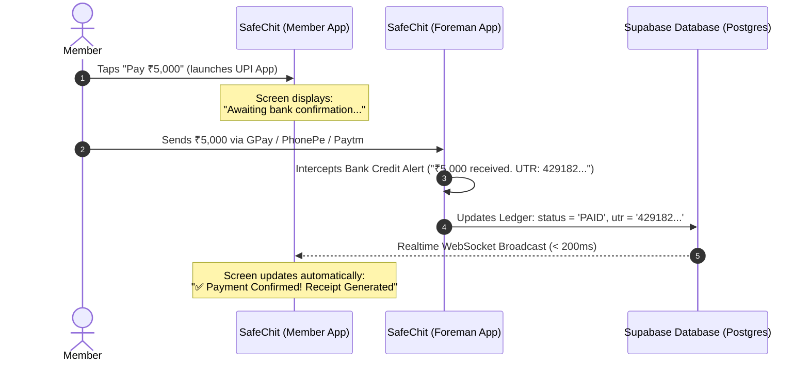

# SafeChit — Zero-Fee UPI & Transaction Architecture Guide
> **Purpose:** Comprehensive engineering & architectural explainer of self-hosted, zero-aggregator-fee UPI payments, cryptographic signature verification (HMAC), banking observation engines, and real-time ledger synchronization for the SafeChit platform.

---

## 1. Executive Summary

Traditional payment gateways like **Razorpay** and **Cashfree** act as financial intermediaries:
* They charge **2.0% – 3.0% + 18% GST** per transaction.
* They hold money in escrow for **T+2 to T+3 business days**.
* They enforce rigid business KYC policies that restrict personal or small-scale chit funds.

This architecture explores a **Self-Hosted, Sovereign UPI Payment Engine** (inspired by open-source systems like **YouPI-PG**) that routes payments **directly from the member's bank account to the Foreman's bank account via standard UPI rails (0% fees, instant settlement)**, verified automatically via banking alerts and synchronized across all members in real-time.

---

## 2. Cryptographic Signatures (HMAC-SHA256) & Anti-Tampering

### A. The Core Problem
When a payment occurs, a client or external service sends a message to the SafeChit backend:
```json
{ "orderId": "ORD-101", "amount": 5000, "status": "PAID" }
```
Without cryptographic protection, an attacker could spoof this message to mark their monthly installment as paid without sending any money.

---

### B. How HMAC Works (The Digital Wax Seal)
> [!IMPORTANT]
> **The Secret Key is NEVER sent over the internet.**  
> It is stored beforehand on both servers in a private configuration file (`.env`).

```
[ PAYMENT GATEWAY / SENDER ]
  Order Data + Secret Key ────────(HMAC Math)────────> Signature A ("d936b36e...")
                                                                │
             Sent Over Network: Data + Signature A              ▼
[ SAFECHIT BACKEND / RECEIVER ]
  Received Data + SafeChit's Secret Key ──(HMAC Math)──> Signature B ("d936b36e...")
                                                                │
                                                                ▼
                                      Does Signature A === Signature B ?
                                            YES  ==> Authentic & Unmodified!
                                            NO   ==> Fake or Tampered!
```

1. **Gateway side:** The gateway takes the **Data** + **Secret Key** and hashes them together to generate a unique 64-character hex signature (`Signature A`).
2. **Network transmission:** The gateway sends the **Data** in the request body and `Signature A` in the HTTP header (`X-Gateway-Signature`).
3. **SafeChit Backend side:** SafeChit takes the **Received Data** and its **own local copy of the Secret Key**, independently calculating `Signature B`.
4. **Verification:** SafeChit compares `Signature A === Signature B`. If they match, the payment is guaranteed to be authentic.

---

### C. Live Real-Time Calculation Example (Tested with Node.js)

#### 1. Legitimate ₹5,000 Payment:
* **Payload:** `{"orderId":"ORDER-101","amount":5000,"status":"PAID"}`
* **Secret Key:** `"safechit_super_secret_key_2026"`
* **Gateway Generated Signature:**  
  `d936b36eb46ccbc53d27a5bb22e973cd9cb17499681bb5ad6f776c64d4b3851d`
* **SafeChit Recalculated Signature:**  
  `d936b36eb46ccbc53d27a5bb22e973cd9cb17499681bb5ad6f776c64d4b3851d`
* **Result:** **MATCH (`true`)** $\rightarrow$ Installment marked as **PAID**.

#### 2. Tampered Payment (Attacker modifies ₹5,000 to ₹50):
* **Tampered Payload:** `{"orderId":"ORDER-101","amount":50,"status":"PAID"}`
* **Attacker reuses old Signature:**  
  `d936b36eb46ccbc53d27a5bb22e973cd9cb17499681bb5ad6f776c64d4b3851d`
* **SafeChit Recalculated Signature:**  
  `384d445969f1dfb82a13ee5d42cc2eeeb145f12ee6b7bf61982b7b2feba2833c`
* **Result:** **MISMATCH (`false`)** $\rightarrow$ Transaction instantly rejected and blocked.

---

### D. Timing Attacks & Timing-Safe Comparisons (`crypto.timingSafeEqual`)

* **What is a Timing Attack?**  
  Standard computer comparisons (`===`) check string characters left-to-right and stop at the first non-matching character. An attacker with a high-precision timer can measure execution time down to nanoseconds to guess characters one-by-one.
* **The Solution:**  
  Using `crypto.timingSafeEqual()` ensures the computer evaluates every character across the entire buffer, taking constant execution time regardless of where mismatches occur.

---

## 3. The Banking Observation Engine (How Transactions are Confirmed)

Standard UPI does not provide public webhooks for personal bank accounts or VPAs. Self-hosted gateways solve this by using an **Observation Engine**.

### A. The Golden Banking Rule: "Debit" vs "Credit"
* **Member's Bank SMS:** *"₹5,000 **debited** from your account."*
* **Foreman's Bank SMS:** *"₹5,000 **credited** to your account. UTR: 429182749102"*

> [!WARNING]
> A **Debit SMS** does not prove a payment succeeded. Funds can get held in clearing or bounce back.  
> **Only the Credit SMS in the receiving account proves the money was received.**

---

### B. Who Needs Permissions? (Foreman vs Member)

* **Foreman Phone (Receiver):**  
  Runs a background listener (via native Android `SMS_RECEIVED` or `NotificationListenerService`) to capture incoming credit alerts from banks, PhonePe, Google Pay, or Paytm.
* **Member Phone (Sender):**  
  **NEVER requests SMS or notification permissions.**  
  Members maintain 100% privacy and pay using their standard UPI apps.

---

### C. The 2-Second Confirmation Loop (Supabase Realtime)



1. Member completes the payment in their UPI app.
2. The Foreman's phone catches the credit SMS/notification within seconds.
3. The Foreman's app extracts the **Amount** and **12-digit UTR** and updates the Supabase ledger table.
4. **Supabase Realtime WebSockets** immediately broadcast the state change to the Member's screen, updating it to **PAID** in under 200ms.

---

## 4. Concurrency: The 2-User Simultaneous Payment Problem

### A. The Challenge
If **Member A** and **Member B** both pay ₹2,000 at the exact same minute:
* The Foreman's bank sends an SMS: *"₹2,000 credited via UPI"*.
* Standard UPI bank alerts **do not include custom order IDs**.
* Without a concurrency engine, the system cannot identify which member paid.

### B. The Solution: Deterministic Single-Slot FIFO Queue
1. **Exclusive Active Slot (5-Minute Window):**  
   When Member A clicks "Pay", the Foreman's VPA is locked to Member A for up to 5 minutes.
2. **Queued Waiting Room:**  
   If Member B clicks "Pay" at the same time, Member B is placed in a live queue:  
   *`"You are #1 in queue. Another payment is currently processing. Your turn begins in ~1 min."`*
3. **Automatic Promotion:**  
   As soon as Member A's payment is confirmed (or cancelled/expired), the slot immediately unlocks for Member B, rendering their dynamic QR code.

---

## 5. Device Binding & Anti-Hijacking (`409 DUPLICATE_SESSION_DETECTED`)

To prevent payment session hijacking or duplicate payments:

* **Real-Time Scenario:**
  1. Member **Rahul** initiates a payment session on **Phone A**.
  2. The session is cryptographically bound to `Phone A`'s unique hardware identifier.
  3. If another user (or a malicious actor) tries to open or submit that same session from **Phone B**, the server detects the mismatch and returns:
     ```json
     {
       "statusCode": 409,
       "error": "DUPLICATE_SESSION_DETECTED",
       "message": "This payment session was created on another device. For security reasons, it cannot be continued from this device."
     }
     ```

---

## 6. Real-World Privacy & WhatsApp OTP Considerations

### A. Why WhatsApp Web Linking is a Risk for Foremen
Some open-source gateways use unofficial WhatsApp Web sockets (Baileys) to send OTPs:
1. **Privacy Barrier:** A Foreman linking their personal WhatsApp risks exposing personal chats, photos, and messages to the server.
2. **Account Ban Risk:** Meta actively bans phone numbers sending automated messages via unofficial Web sockets.

### B. The SafeChit Advantage
* On random e-commerce storefronts, WhatsApp OTP is needed because buyers are unknown strangers.
* **In SafeChit, all members are already KYC-verified and authenticated** (via phone number, Aadhaar, and password).
* **Recommendation:** SafeChit can completely bypass WhatsApp OTP for chit installment payments, avoiding any privacy risks or phone bans.

---

## 7. In-Person Cash Modalities (`CASH_COUNTER` & `CARD_COUNTER`)

In traditional chit funds, many members pay cash in person during monthly meetings:

1. **Member pays Cash:** Hands ₹5,000 in physical cash to the Foreman.
2. **Foreman Records in SafeChit:**
   * Selects member $\rightarrow$ Clicks **"Record Cash Payment" (`CASH_COUNTER`)**.
   * Confirms receipt.
3. **System Outcome:**
   * SafeChit marks the installment as `PAID (Method: CASH)` in the Supabase ledger.
   * Generates a digital receipt for both the Foreman and the Member.
   * Member's app dashboard reflects the cash payment immediately.

---

## 8. Architecture Comparison Summary

| Metric / Feature | Traditional Razorpay / Cashfree | Open-Source YouPI-PG | SafeChit Integrated Architecture |
| :--- | :--- | :--- | :--- |
| **Transaction Fees** | 2.0% – 3.0% + 18% GST | **0.0% (Free)** | **0.0% (Free)** |
| **Settlement Time** | T+2 to T+3 Business Days | **Instant (Direct Bank VPA)** | **Instant (Direct Foreman Account)** |
| **Merchant KYC Requirement** | Strict corporate / business entity | None (Works with any UPI ID) | None (Works with any Foreman VPA) |
| **Observer Source** | Banking API Webhooks | Separate Android APK / Gmail | Built directly into SafeChit (Foreman Mode) |
| **Member UX** | Third-party checkout overlay | Responsive web modal | Native Flutter screen + UPI app intent |
| **Simultaneous Payment Safety** | Virtual Accounts | Deterministic Single-Slot FIFO | Single-Slot Queue + Supabase Realtime |
| **Offline Cash Support** | No (Manual spreadsheet) | Built-in Till Desk | Built-in `CASH_COUNTER` Ledger |

---

*Document generated for the SafeChit Project Architecture Repository.*
