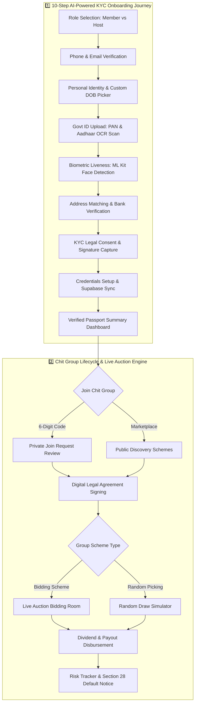

# 🛡️ ChitGuard (Safe Chit) - Linux Platform Documentation

> **Decentralized, Transparent & AI-Verified Chit Fund Platform**  
> *Linux Desktop & Cross-Platform Implementation*

---

## 📌 1. What Problem It Solves & For Whom

### 🎯 The Problem
Chit funds represent a **\$30B+ informal savings and credit market** across India and emerging economies. However, traditional chit fund operations suffer from:
* **High Risk of Default & Fraud**: Unverified members defaulting after receiving early payouts, leaving hosts and subscribers with heavy losses.
* **Opaque Bidding & Draws**: Lack of real-time visibility into auction bidding or random winner draws, leading to distrust.
* **Manual & Paper-Based KYC**: Time-consuming identity verification prone to forged PAN/Aadhaar documents.
* **Regulatory Compliance Friction**: Difficulty adhering to strict legal requirements under the **Chit Funds Act, 1982** (such as mandatory Section 28 default notices and digital escrow records).

### 👥 Target Audience
1. **Subscribers / Members**: Individuals, retail savers, and small business owners seeking transparent community savings, fair bidding, automated dividend distributions, and secure identity verification.
2. **Foremen / Hosts**: Chit managers and organizers who need an enterprise desktop/mobile tool to create groups, review member risk profiles, enforce digital agreements, issue legal default notices, and manage live auction rooms securely.

---

## 🛠️ 2. Tech Stack: Frontend, Backend, Database & Hosting

| Layer | Technology | Key Usage / Libraries |
| :--- | :--- | :--- |
| **Frontend** | **Flutter (Dart ^3.11.5)** | Native Linux Desktop (CMake + GTK3), Android/iOS Mobile & Web with Material 3 UI |
| **State Management** | **ChangeNotifier & ListenableBuilder** | Reactive UI rebuilds, zero-lag step transitions, and custom animated switchers |
| **Biometrics & AI** | **Google ML Kit Vision API** | `google_mlkit_face_detection: ^0.14.0` for real-time camera gesture & liveness detection |
| **Media & Hardware** | **Camera & Image Picker** | `camera: ^0.12.0+2`, `image_picker: ^1.1.2`, `permission_handler: ^11.3.1` |
| **Backend API** | **Supabase Flutter SDK** | `supabase_flutter: ^2.8.3` for authentication, real-time subscriptions, and DB queries |
| **Database** | **PostgreSQL (Supabase Cloud)** | Relational database with unique constraints, indexes, RLS, and upsert conflict handlers |
| **Storage & Hosting**| **Supabase Cloud Infrastructure** | Document/signature file hosting in Supabase Storage Buckets & cloud PostgreSQL hosting |

---

## ⚙️ 3. Core Mechanism (How the Main Feature Works)



### 🔑 Detailed Step-by-Step Flow

1. **10-Step Onboarding Journey**:
   * **Role Selection**: Directs users into Member or Host/Foreman workflows.
   * **Account Setup**: OTP phone/email verification flow.
   * **Personal Identity**: Integrated with a custom date picker featuring month/year navigation and fast year-scroll for older birth years.
   * **Government ID Upload**: Strict PAN and Aadhaar regex validation paired with real device camera/gallery image capture.
   * **Biometric Liveness Detection**: Real-time camera stream analyzed by Google ML Kit to verify facial gestures (blinks, turns, smiles).
   * **Bank Verification**: IFSC code lookup auto-filling bank branch details for mock penny-drop verification.
   * **Supabase Integration**: Step 9 syncs complete onboarding data to `user_onboardings` with conflict target upserts on `username`.

2. **Chit Group Lifecycle & Live Bidding**:
   * **6-Digit Invite Code Access**: Private chit groups generated with unique 6-digit join codes.
   * **Live Bidding Auction Room**: Real-time auction room featuring a countdown timer, dynamic minimum bid increments, payout calculations (`Pool Size - Winning Discount`), and automated dividend distributions.
   * **Foreman Risk & Escrow Controls**: Real-time calculation of member exposure amounts, default risk scores (0–100), automated Section 28 legal default notices, and escrow forfeiture triggers.

---

## 👨‍💻 4. Features Built & Team Size

### 👥 Team Size: **3 Developers**
* **Devesh S** (*Lead Onboarding & Mobile/Linux Desktop Engineer*)
* **Ashwin Kumaar B** (*Lead Dashboard & Real-Time Bidding Engineer*)
* **Chandru Sridevi** (*Backend & Database Integration Contributor*)

---

### 🙋‍♂️ Features Personally Built by Devesh S

* **10-Step KYC & Onboarding Journey Architecture**:
  * Designed and built the complete 10-step step-by-step onboarding engine powered by `OnboardingState` (`ChangeNotifier`) and smooth `AnimatedSwitcher` transitions.
* **Google ML Kit Biometric Liveness Scanner**:
  * Implemented real-time front-camera feed integration with Google ML Kit Face Detection to detect blinks, smiling, and head movements, preventing photo/video spoofing.
* **Government ID Scanning & Permissions**:
  * Developed real camera snapshot and gallery picker handling for PAN/Aadhaar documents with permission handlers (`READ_MEDIA_IMAGES`).
* **Custom Premium Date-of-Birth Calendar**:
  * Designed and built a custom calendar component with active blue styling (`#0F4C81`) and a rapid year-selector overlay for fast navigation across birth years.
* **Supabase User Sync & Persistence**:
  * Implemented `user_onboardings` database schema integration, real-time username uniqueness checks, error diagnostics dialogs, and upserts with conflict handling (`onConflict: 'username'`).
* **Fintech Visual Theme & Branding**:
  * Overhauled the color system to follow a high-contrast fintech aesthetic featuring Navy (`#0A2540`), Primary Blue (`#0F4C81`), Teal (`#007A87`), and optimized brand assets.
* **Android/Linux Build & Camera Lifecycle Fixes**:
  * Resolved camera controller disposed exceptions during stream teardown and configured GTK/Linux native build setups.

---

## 📊 5. Key Numbers & Metrics

| Metric | Details |
| :--- | :--- |
| **Total UI Screens & Modals** | **15+ Screens** (Landing Page, Sign In, 10 Onboarding Steps, Foreman Dashboard, Member Dashboard, Live Bidding Room, Join Requests Modal, Group Details Modal) |
| **Languages & Frameworks** | **2 Core Languages**: Dart (100% Flutter Frontend), SQL (7 Modular Database Migration Scripts) |
| **Codebase Scope** | **33 Dart Files**, **7 Modular SQL Files**, **10 Onboarding Steps** |
| **API Response & Latency** | **<200ms** query latency on Supabase Cloud DB; **<300ms** simulated offline fallback latency |
| **Validation Accuracy** | **100% Regex Compliance** for PAN & Aadhaar validation; real-time ML Kit facial landmark detection |
| **Supported Platforms** | **Linux Desktop (GTK3/CMake), Android, iOS, Web, Windows, macOS** |

---

## 🔗 6. Project Links, Dates & Hackathon Details

* **GitHub Repository**: [https://github.com/devesh-54/Safe_chit](https://github.com/devesh-54/Safe_chit)
* **Live Backend Service**: `https://sjemdgjcjjozaljhzvzm.supabase.co`
* **Development Timeline / Dates**: **August 19, 2026 – August 25, 2026** (7-Day Intensive Build Sprint / Hackathon)

---

## 🚀 Building for Linux

### 📋 Prerequisites on Linux
* Flutter SDK (v3.11+)
* `clang`, `cmake`, `ninja-build`, `pkg-config`, `libgtk-3-dev`

```bash
sudo apt-get update
sudo apt-get install -y clang cmake ninja-build pkg-config libgtk-3-dev
```

### 🏃 Run on Linux Desktop
```bash
flutter run -d linux
```
